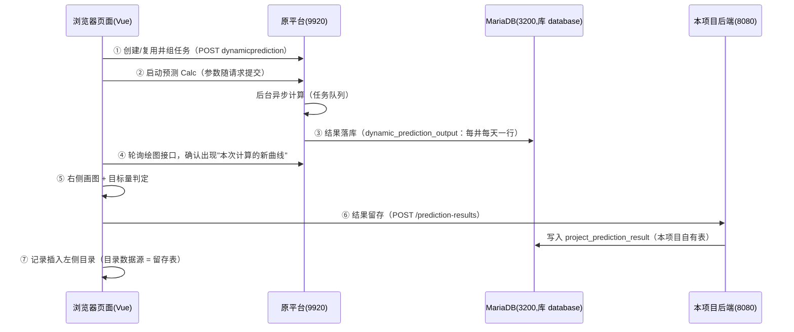

# 库-协同预测-一体化耦合优化：模块流程说明

> 面向项目成员的入门说明：这个模块做什么、怎么用、数据怎么流转、代码在哪里。
> 技术细节（接口实证过程、字段清单、行号级实现）见同目录《一体化耦合优化-功能实现说明.md》。

## 一、一句话认识这个模块

在**储气库**页面上，调用"智慧气藏"原平台（9920）的「动态预测-井组动态预测」能力做**井组采气预测**：
选井 → 调参 → 启动预测 → 右侧出曲线 → 与目标需求量对比判定 → 预测结果**留存到本项目数据库**、记录挂在左侧目录里。

两个菜单入口（功能一样，差异如下）：

| | 单目标 | 多目标 |
| --- | --- | --- |
| 优化目标 | 目标产量 | 目标产量 + **井口外输压力** |
| 右侧输出 | 气产量、累产气量（2 条线） | 气产量、累产气量、地层压力、采出程度（**4 条线**，与原平台一致） |

菜单位置：**库 → 协同预测 → 一体化耦合优化 → 单目标 / 多目标**。

## 二、用户操作流程（完整路径）

```
① 第一次使用
   展开左侧「单目标」目录 → 点「新建预测」
   → 参数自动带出（原平台从数据管理取真实数据，不需手填）
   → 按需修改参数（目标产量、外输压力、预测时间等）
   → 点「启动预测」→ 右侧出图；记录自动出现在目录里

② 之后每次进入
   自动载入本模式"最近一条"记录：参数 + 已有曲线（不重算）

③ 回看历史
   展开目录 → 点某条记录 → 载入该次预测的参数与结果

④ 删除记录
   右键记录 → 「删除预测记录」→ 确认
   （= 删除平台任务及其结果 + 删除本项目留存，不可恢复）

⑤ 目标量判定
   面板最底部输入「目标需求量」→ 自动计算：
   计算量 = 预测期首尾累计气产量差；计算量 ≥ 目标量 → ✓ 满足 / ✗ 不满足
```

要点：
- 目录里的**「新建预测」固定在记录列表顶部**；新建的动作本身不产生记录——**启动预测并留存成功后**记录才出现。
- 两个模式各自维护自己的记录集合（不串）。

## 三、一次「启动预测」发生了什么（系统流程）



## 四、数据存在哪里（重要，别混了）

| 数据 | 存放位置 | 写入者 | 页面上哪个功能读它 |
| --- | --- | --- | --- |
| 预测任务（名称、参数、井集合） | 原平台表 `dynamic_prediction` 等 | 原平台 | 载入参数、启动计算 |
| 平台计算结果（逐日曲线数据） | 原平台表 `dynamic_prediction_output` | 原平台后台 | 右侧曲线、目标量判定 |
| **留存记录（本模块专属）** | 本项目表 **`project_prediction_result`** | **本项目后端**（预测成功后前端调用） | **左侧记录目录**、后续查询/导出 |
| 记录属于单/多目标 | 留存记录自带的 `mode` 字段 | 同上 | 目录按模式过滤 |

- 原平台与我们的后端**共用同一个 MariaDB**（`database` 库），但表各自独立。
- 表由**后端启动时自动幂等创建**（`predictionresult` 模块），团队成员拉代码重启后端即可，不需要执行/分发 SQL 文件；`backend/sql/prediction_result.sql` 仅用于部署审计和手工初始化。
- **历史旧任务不迁移**：目录只显示留存过的记录；平台上的旧任务不出现在目录里（但仍在原平台"分析结果"中）。

## 五、关键规则与常见问题

| 规则/问题 | 说明 |
| --- | --- |
| 井组至少 2 口井 | 与原平台一致，不足时不允许启动 |
| 任务名称不能重复 | 平台唯一约束是「项目+气藏+名称+类型」；改井选择重建任务时**名称自动顺延**（如"井组动态预测 13"），不会报"分析已存在" |
| 目录里看不到记录？ | 该模式还没有留存过的预测 → 点「新建预测」开始第一条 |
| 报表/换电脑后记录还在吗？ | **在**——记录与归属都在后端数据库，不再依赖浏览器缓存 |
| 删错了能恢复吗？ | 不能。删除 = 平台任务及其结果 + 本项目留存一并删除 |
| 曲线数值的单位感觉偏小？ | 平台产量的数值口径尚未真机核对（字段值与实际产量差约 8.6 倍），图轴标注可能需修正——**判定逻辑不受影响**（以图为准的相对比较） |

## 六、代码地图（开发视角）

| 位置 | 职责 |
| --- | --- |
| `vue/src/views/Reservoir/CouplingOptimization/CouplingOptimization.vue` | 页面组件：左侧参数面板/判定区，右侧曲线 |
| `vue/src/api/wellGroupPrediction.js` | 原平台接口封装（创建/详情/Calc/绘图/删除任务/默认名） |
| `vue/src/api/predictionResult.js` | 本项目后端留存接口（保存/列表/删除） |
| `vue/src/utils/wellGroupPrediction.js` | 纯函数：请求组装、曲线解析、目标量判定、留存请求体 |
| `vue/src/utils/couplingOptimizationTree.js` | 左侧目录：懒加载记录、「新建预测」动作节点、保存后插入、删除后摘除 |
| `vue/src/views/IprInterface.vue` | 工作台接入：目录点击/展开、右键菜单（删除预测记录）、URL 定位 |
| `backend/.../predictionresult/` | 留存表自动建表 + 保存/列表/删除接口 |
| `vue/tests/wellGroupPrediction.test.js` + `tests/e2e/coupling-optimization.spec.js` | 单元测试（19）与端到端测试（7 个场景，全 mock 免登录） |

## 七、给接手开发者的三个提醒

1. **右键菜单谓词**：`IprInterface.vue` 的 `isTreeContextMenuNode` 是全类型联合（曾有"新增类型把旧类型顶掉"的回归，已修复）——**新增可删除类型时必须追加、不要替换**。
2. **任务准备策略**：进页面复用"本模式最近留存记录"；**没有留存记录时不自动创建任务**（历史上自动创建导致刷新页面堆积平台任务）。"启动预测"在无任务时也可直接创建。
3. **平台接口以实证为准**：本模块所有原平台接口/字段都经过抓包或容器产物核对（见《功能实现说明》第二章）；改动计算链路前先核对原平台行为，不要凭猜测改字段。
